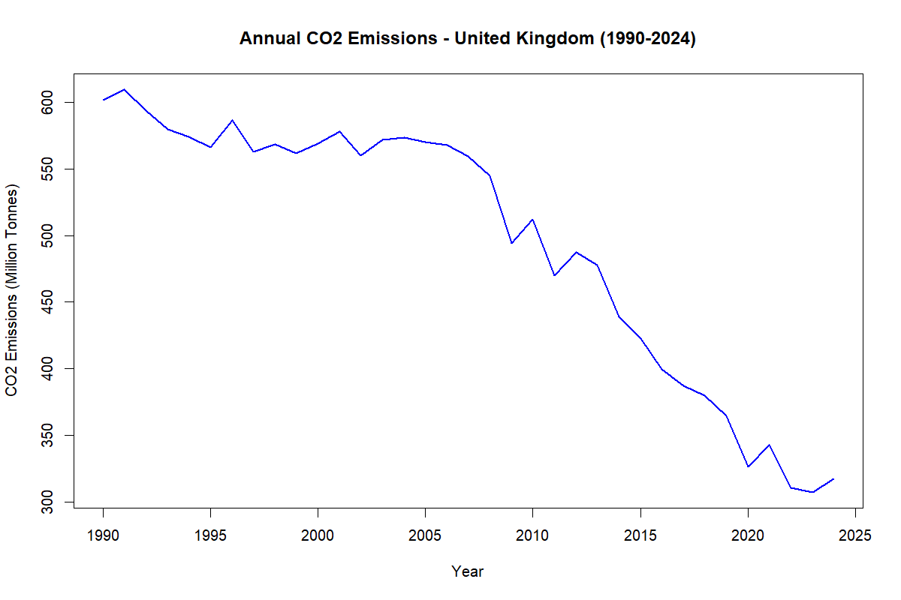
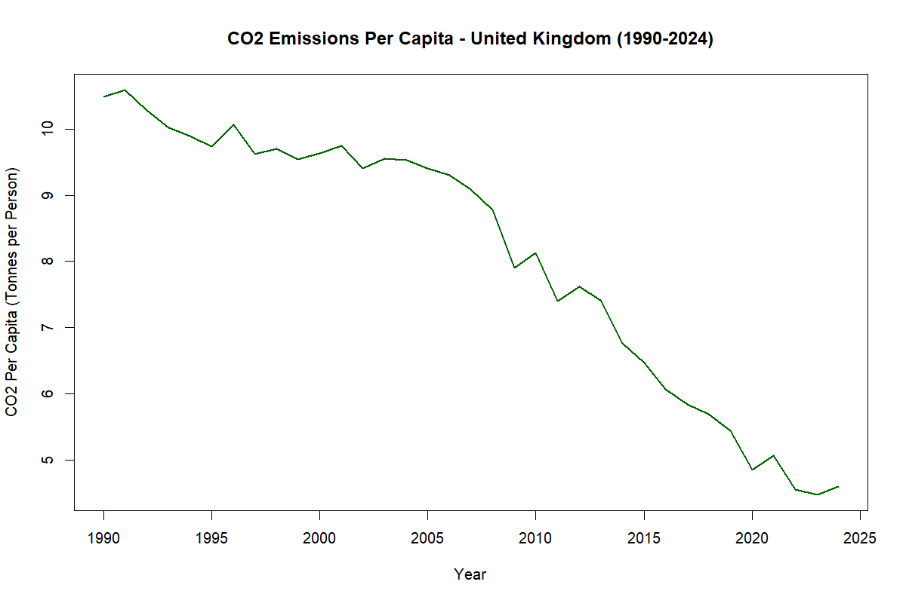
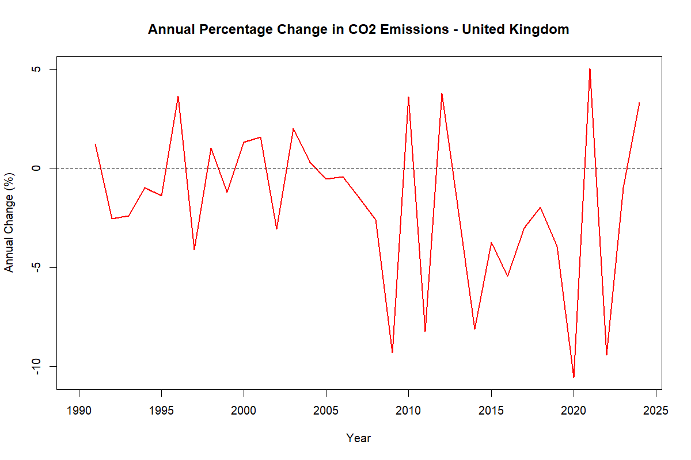

# United Kingdom CO2 Emissions Analysis (1990–2024)

## 1. Research Question

How have carbon dioxide (CO2) emissions in the United Kingdom changed from 1990 to 2024?

## 2. Data Source

The dataset was obtained from [Our World in Data – CO2 and Greenhouse Gas Emissions](https://ourworldindata.org/co2-and-greenhouse-gas-emissions).

The analysis uses the United Kingdom (GBR) data from 1990 to 2024.

## 3. Methodology

The dataset was filtered to include only the United Kingdom and the years 1990–2024.

The analysis used descriptive methods to examine:
- Annual CO2 emissions.
- CO2 emissions per capita.
- Annual percentage change in CO2 emissions.

RStudio was used to process the dataset, generate graphs, and calculate summary statistics.

## 4. Results

The United Kingdom's CO2 emissions decreased from approximately 601.95 million tonnes in 1990 to 317.55 million tonnes in 2024, representing an overall decrease of approximately 47.25%.

The highest emissions in the selected period occurred in 1991, reaching approximately 609.41 million tonnes. In 2024, CO2 emissions per capita were approximately 4.59 tonnes per person.

### Annual CO2 Emissions

### CO2 Emissions Per Capita

### Annual Percentage Change

## 5. Interpretation and Discussion

The results show a substantial decline in the United Kingdom's CO2 emissions between 1990 and 2024. Although emissions reached their peak in 1991, the overall trend across the study period indicates a reduction in annual emissions. The decline suggests changes in the country's energy consumption and emissions-producing activities over time. However, this descriptive analysis does not establish the specific causes of the reduction.

## 6. Limitations

This study is limited to CO2 emissions data from 1990 to 2024. It uses descriptive analysis and does not independently test the causes of changes in emissions or establish relationships with other environmental and economic variables.

## 7. References

Our World in Data. CO2 and Greenhouse Gas Emissions. https://ourworldindata.org/co2-and-greenhouse-gas-emissions

Our World in Data. CO2 dataset. https://owid-public.owid.io/data/co2/owid-co2-data.csv
